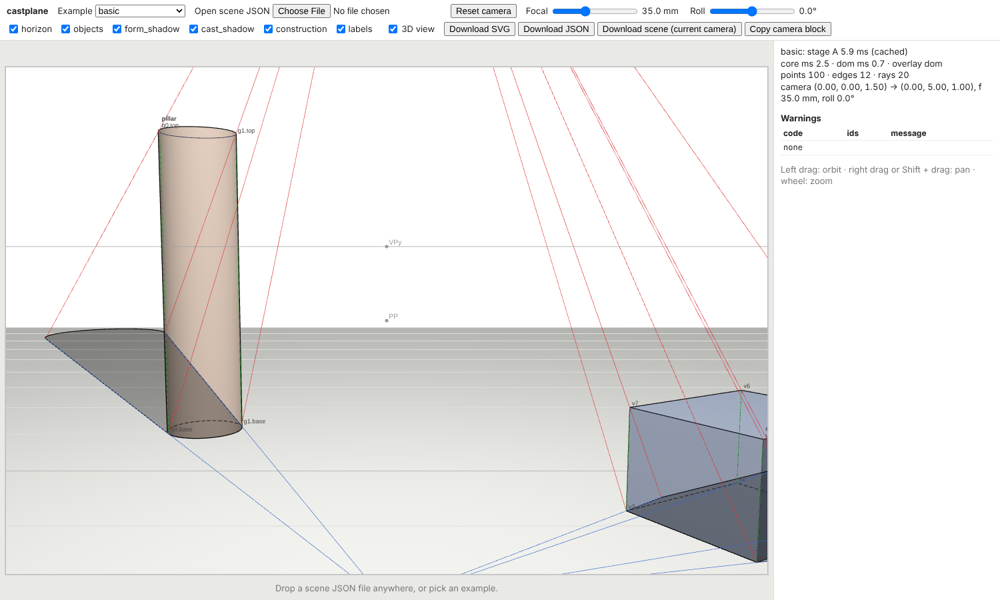
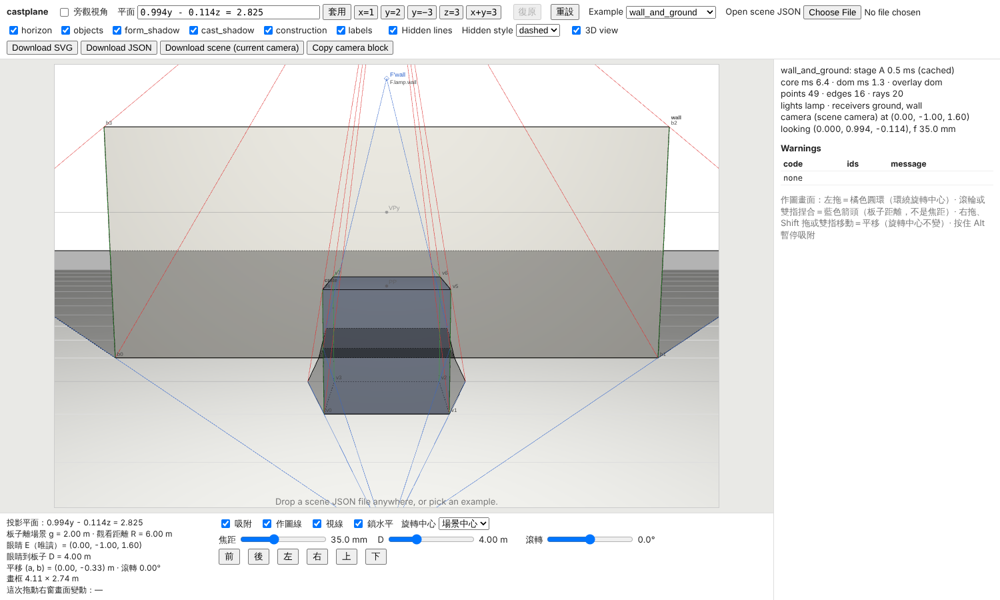
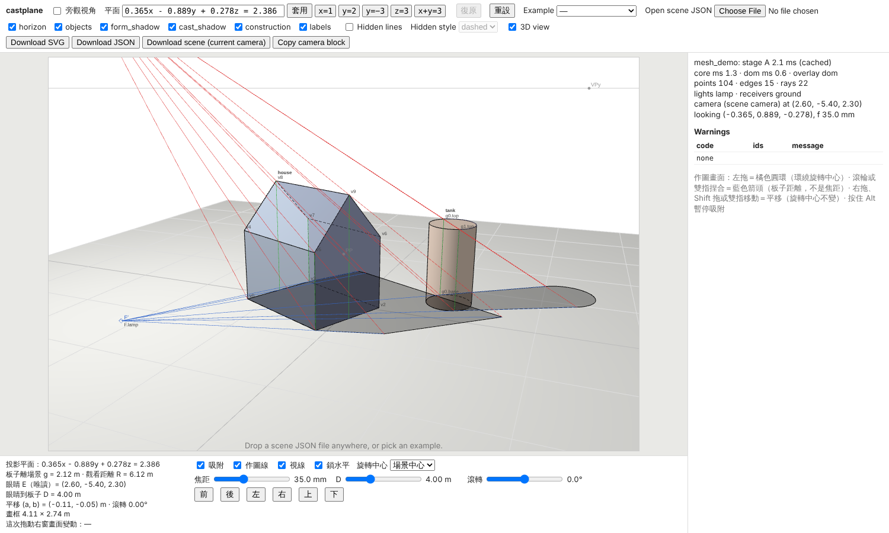
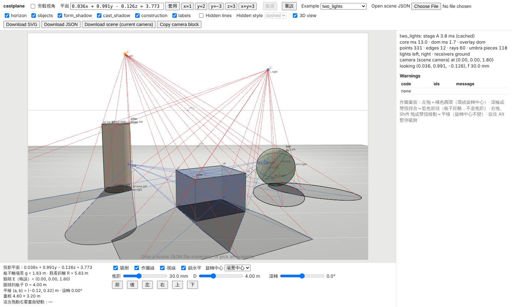
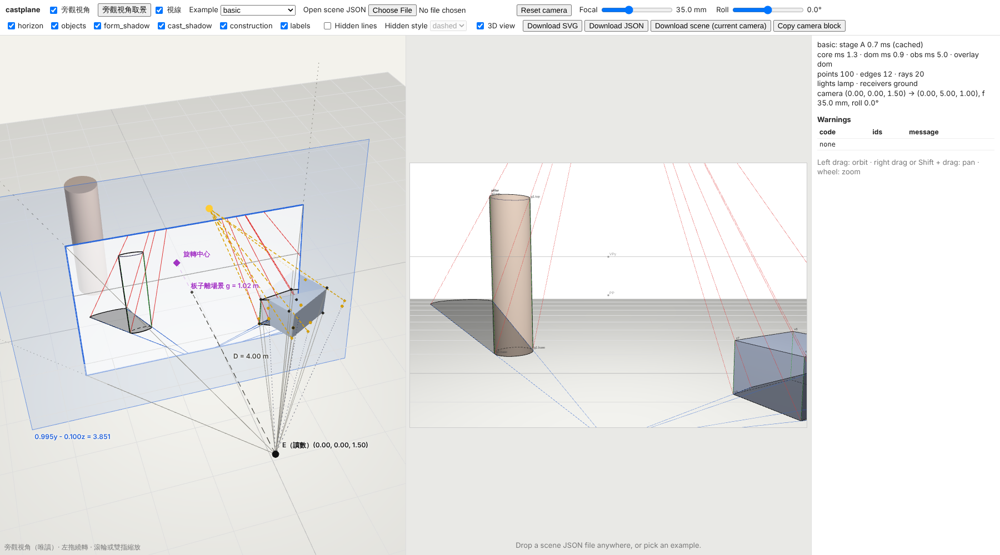
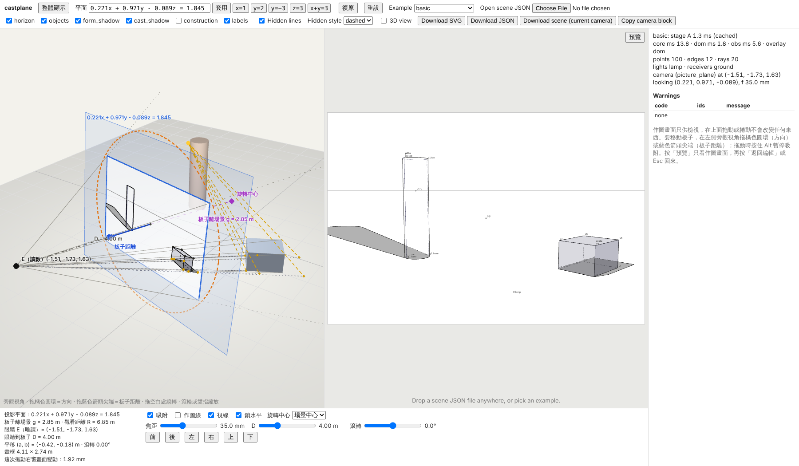

# castplane web UI

The three.js web UI of the castplane TypeScript port (contract `docs/ARCHITECTURE.md` §5.4.10). Load a scene JSON,
look at it in 3D, move the board that defines the camera, and see the perspective shadow construction drawing that the ported core
(`ts/`) writes for that camera, laid exactly over the 3D view. It is static (no server, no network access at
runtime). The examples are bundled at build time.

```sh
npm ci                     # at the repository root (npm workspace: ts, web)
npm run -w ts build        # the core package "castplane" the UI imports
npm run -w web dev         # vite dev server
npm run -w web build       # tsc type check + vite build -> web/dist (static, base './')
npm run -w web preview     # serve web/dist locally
npm run -w web test        # orbit / download / colours / rig / equation / observer / plane / object-rotation / limits / core-worker (core_client, core_engine, doc_summary, art_buffers) unit tests (node:test, web/test/; 197 tests)
```



Phase 2 (contract §5.4.10, the M4–M6 format): `wall_and_ground` with hidden lines on, the expanded `mesh_demo`, and
`two_lights`:





M9 (contract §5.6): the observer view, shown by default (hidden by the *預覽* button, D80):



M10 (contract §5.7): plane mode, the board moved with the orange ring and the blue arrow (here after `y=2` and a ring
drag):



## What it does

- **Loading**: the *Example* menu (every `examples/*.json`, eight files, embedded by `import.meta.glob`), the file picker,
  or a file dropped anywhere on the page. A dropped file that is not JSON shows "not a JSON file". A scene
  that fails validation shows the `SceneError` field path and message in the error panel, and the previous
  scene stays loaded. The core reads expanded scenes only (contract §5.4.0): a `mesh` object must carry its
  geometry inline (`data`), so the bundled `mesh_demo` example, which names `meshes/house.obj`, shows the
  "mesh file must be expanded first" error; load an expanded scene instead (`castplane.io.expand_scene` of the
  example, or `castplane import FILE -o scene.json --inline` for a new scene).
- **3D view** (`src/scene3d.ts`, `src/mesh3d.ts`, `src/threeCamera.ts`): boxes, cylinders, cones, spheres, prisms
  and inline meshes (a `BufferGeometry` of the core's preprocessed triangles, taken from stage A so a mesh is not
  preprocessed twice, both sides drawn) placed with
  the core's `transform_frame`; light helpers, **one per light** in its own colour (a sphere for a point light, an
  arrow for a directional light; `src/helpers3d.ts`), whose three.js shading lights share one total intensity so a
  scene with several lights is not drawn brighter; and the receivers: the unbounded ground as a large plane with a
  grid, and each **bounded receiver as a plate** over its `bounds` (a triangle fan of the validated convex polygon,
  world coordinates) with an outline. The three.js camera is built from the core's `camera_matrix` (no `lookAt` and no
  `fov`), so the WebGL image and the SVG overlay are two renderings of one castplane camera. Three.js casts no
  shadows (`renderer.shadowMap.enabled = false`). Every shadow you see comes from the core.
- **Display colours** (D81, `src/colours.ts`, pure and unit-tested in `web/test/colours.test.ts`). An object may carry
  `display_color`, a string `"#rrggbb"` (`#` plus exactly six hex digits, either case). The 3D views (the drawing
  pane's *3D view* and the observer pane, both through `build_scene3d(scene, A?, colours?)`) draw that object in that
  colour as the `MeshLambertMaterial` colour, so it is still shaded by the scene's lights; in the observer pane only the
  receiver plates are see-through. An absent or invalid value (no `#`, another digit count, non-hex digits, spaces, a
  non-string) keeps the palette colour of the object's index, `PALETTE[i % 8]`, with no error and no warning. The key
  is display-only: the validators ignore it like any unknown key (contract §2.0), so the validated scene drops it
  and the document, the SVG and the warnings are byte-identical with or without it. It is read from the **raw JSON**
  where a scene is loaded (`ex.data` for a bundled example, the parsed text for the file picker, a drop and the
  `castplane_web.load_text` hook) into a `Map` by object id (`display_colours`); malformed entries are skipped silently.
  `PALETTE` moved from `scene3d.ts` to `colours.ts`, its values unchanged.
- **Modules**: `src/main.ts` keeps the page state, loading, the wiring and the render loop. `src/plane.ts` is plane
  mode's session (the rig of `src/rig.ts`, undo, pivot, readouts; pure, unit-tested). `src/object_rotate.ts` (pure)
  holds the object-rotation maths and the `ObjectDrag` state machine (M11, below). The drawing pane has no input
  handler (below). `src/stage.ts` is one three.js view (`Stage3D`, plus `letterbox` for the canvas size), `src/input.ts`
  handles the page-wide file drop, `src/colours.ts` (pure) holds the display colours of the 3D views (above), and `src/ui.ts` drives the controls and the side panel (layer boxes, examples menu,
  sliders, readouts, error panel, warnings table, status line, `save` for downloads). `src/orbit.ts` (the M7 camera)
  is kept with its tests; only its focal-slider mapping is still used.
- **Camera: plane mode** (M10, contract §5.7; `src/rig.ts`, `src/plane.ts`, `src/equation.ts`). You move the
  **board** (the picture plane), not the eye: its direction `f` and its distance `g` from the pivot. The eye `E` sits
  `D` behind the board and is computed (read-only): `E = P − (g + D)·f + L`, with `L` the pan. On load the scene's
  camera is turned into this state (pivot = scene centre, `D` = the `picture_plane` distance or 4 m). `R = g + D` is
  clamped into 0.8–40 m and `D` into 0.5–12 m, with a notice when a clamp changes the picture.
  - Drawing pane (right) is **read-only** (D79, spec-v0.2 §5.9): any drag on it (left, right or middle button,
    Shift, touch with one or two fingers, pen) and the wheel do nothing, quietly: no error, no hint, no undo step, no
    camera change, no grab cursor. It does not call `preventDefault` on wheel or touch events (the page scrolls
    natively; `touch-action` is the browser default on `#stage` and `none` only on `#observer`) and does not suppress
    the context menu. A file drop still works anywhere on the page. The former mappings (left drag = ring, wheel or
    pinch = arrow, right drag / Shift drag / two-finger move = pan) are removed.
  - Observer pane (left, shown by default) is where the board is moved: drag the orange dashed ring to orbit (lock-horizontal by default, free roll
    with *鎖水平* off), and drag the blue arrow's tip (*板子距離*) to move the board along `f`. Hit radius: 14 px
    for a mouse, 26 px for touch, 0.8× for the ring; the tip wins. The black eye is never a handle. Anywhere else
    the drag orbits the observer camera; the wheel or a pinch zooms the observer camera. While previewing (*預覽*)
    no drag or wheel changes the camera: use the sliders, views, equation field, undo and 重設, or go back with
    *返回編輯* (or Esc).
  - *吸附* (default on; Alt suspends it): within 5° of an axis the board snaps to it exactly, and an axis-parallel
    board's plane coordinate snaps to 0.1 m while the arrow is dragged.
  - Sliders: focal length (logarithmic, 8–400 mm), `D` (0.5–12 m, the board stays and the eye moves), roll (±180°
    about the line of sight; the eye stays). None of them is an undo step.
  - *旋轉中心*: 場景中心, or 點選物體 then click an object in the observer pane. The eye moves onto its axis (the pan
    is cleared). This is not an undo step. The pan `(a, b)` is no longer user-editable: it comes from the load rule
    (an eye off the pivot's axis) and is cleared by an object pick and by a view.
  - Views 前 後 左 右 上 下 (`f = +y, −y, +x, −x, −z, +z`; pan and roll cleared).
  - The plane-equation field always shows the current plane (`y = 2.00`, `0.707x + 0.707y = 1.200`). Type a linear
    equation in `x`, `y`, `z` and press Enter or 「套用」, or use the quick buttons `x=1`, `y=2`, `y=−3`, `z=3`,
    `x+y=3`. A bad equation turns the field red with the reason and keeps the plane.
  - 復原 (50 steps) and 重設 (the loaded state).
  - Readouts under the panes: the plane, `g` and `R`, `E`, `D`, pan and roll, the frame size in metres, and
    "這次拖動右窗畫面變動" (the largest image displacement of all object vertices since the start of the last drag, in
    frame mm; the drag is a ring or arrow drag in the observer pane). A notice appears when the eye is below the ground.

  Until the first change after a load or 重設, the core renders the scene's own camera, so the document and the
  downloads equal the CLI's. From then on it renders the rig's explicit `picture_plane` block (`position` plus
  `picture_plane {normal, offset[, up]}`; `up` only when not lock-horizontal or roll ≠ 0).
- **Rotate one object** (M11, contract §5.8, spec-v0.3, D82, D83; `src/object_rotate.ts`, `PlaneSession.update_scene`).
  Modeless (D83): there is no toggle; clicking an object in the observer pane selects it and its rings appear next to
  the board's handles. The camera, the board (rig, pivot `P`, plane), the eye, the lights and the receivers never
  change, only the selected object's `transform` does. Web only: the core, the port and the conformance set are untouched, and an unrotated scene renders
  byte-identically to before.
  - The observer pane's hit order on pointer-down is the selected object's rings > the board's arrow tip > its orange
    ring > object (a click of less than 5 px selects it; with the pivot set to *點選物體* the same click also picks it
    as the pivot) > empty space (a drag orbits the observer camera, a click clears the selection and hides the rings).
    Nothing is selected after a load, also in a single-object scene. The hover cursor covers the object rings too.
  - The *板子* checkbox (next to *視線*, on by default) hides, in the observer pane only, the board group (eye, board
    patch, frame with the drawing, frustum, principal point, `D` and `g` lines, pivot marker, the orange ring and the
    blue arrow) and its labels; the board's handles are then not hit-tested, so a press there orbits or clicks. The
    object rings and the *視線* rays stay; the drawing pane, the outputs, the camera block, undo and *整體顯示* are
    unchanged; it is not an undo step and not stored in the scene. A change while a board-handle drag is held is
    ignored.
  - The selected object gets three rings around its pivot `c_w` (the centre of its **local** bounding box, which does
    not move while it rotates): x red, y green, z blue, about the world axes. Dragging a ring turns the object by the
    total pointer displacement (0.32°/px, snapped to 15° with *吸附*, Alt suspends it) and stage A re-runs live, at most
    once per frame, so the shadow and the drawing follow the drag. The object's `position` changes with the rotation so
    that `c_w` stays put.
  - The panel's *物體* section: the object dropdown (kept in sync with a click in the observer pane; "—" clears the
    selection), the `rx` `ry` `rz` fields in degrees with *套用* (or Enter; angles typed into several
    fields apply together, Esc drops them; a field that is not a finite number turns red and keeps its value),
    *還原此物體* (back to the load-time transform), *落地* (shown only when `receivers[0]` is an unbounded plane: moves
    the object along its normal until the lowest vertex touches it) and the `c_w` readout. Angles are shown to 0.1° in
    (−180°, 180°] and are not unwrapped (170° plus 30° reads −160°). While previewing (*預覽*) the observer pane is
    hidden and only the panel works.
  - A ring drag, a *套用*, a *還原此物體* and a *落地* are one undo step each, in the same 50-step stack as the board
    (*復原*); *重設* still resets only the board. A drag released at once still commits its last pose, and a second
    finger cancels the gesture and restores the pressed pose.
  - Turning about x or y can push the object through the ground: the core clips it and warns `OBJECT_BELOW_RECEIVER`
    (expected; *落地* puts it back on the ground). A scene whose stage A took more than `LIVE_STAGE_A_MS` = 150 ms at
    load only moves the 3D proxy while dragging and recomputes on release, with the notice 此場景拖動放開後更新. A
    failed recompute keeps the committed pose and shows 核心重算失敗，請回報.
  - *Download scene* writes the rotated `transform` (full doubles), so `castplane render` of the file reproduces the
    drawing. Hooks for the smoke test: `castplane_web.rotate_object`, `set_object_rotation`, `select_object`,
    `object_transform`, `object_vertices`, `object_centre`, `rotate` (selection and panel state), `object_rings_px`,
    `pick_at(x, y)` (the object a click there selects), `set_board_visible(on)` and `board_visible()` (D83).
- **Groups of parts** (D84, contract §5.8 notes, spec-v0.3 §8; `src/groups.ts`, the group maths of
  `src/object_rotate.ts`). An object may carry the web-only key `group` (a non-empty, non-whitespace, UTF-8
  encodable string, kept verbatim; the core ignores it, *Download scene* writes it back; unrelated to OBJ `g` groups and `smooth_groups`).
  A group with two or more members in the scene is one unit; other objects behave as in D83.
  - A click on a grouped object selects the whole group, the next click the clicked part, the next the whole group
    again; after part focus a click on another part of the group moves the focus there; only a click on blank space
    clears. The dropdown lists the groups first (`group.<name>`, label 「<name>（整組，<n> 個部件）」), and a line
    under it names the selection. With the pivot set to *點選物體* the click puts `P` on the selected unit's centre.
  - A whole group turns rigidly about `c`, the centre of the load-time world bounding box of its members (frozen:
    only the group's *落地* and *還原此物體* move it). Its rings are centred on `c` with a radius from that box (larger
    than a part's; they hit on the band only, so a click inside still picks a part); the fields show the rotation
    relative to the load; *還原此物體* restores every member and *落地* moves the whole group by one common amount.
    A part keeps M11's behaviour and never changes the group's reading or `c`. One group action is one undo step with
    every member and the group frame (`UnitDrag`, `UndoStack.record_objects`).
  - Hooks: `click_object(id | null)`, `selection()`, `select_group(name)`, `rotate_group(name, axis, deg)`,
    `set_group_rotation(name, r)`, `group_rotation(name)`, `group_centre(name)`, `object_groups()`; `select_object(id)`
    still selects an object as a part.
- **Linked parts** (D85, contract §5.8 notes, spec-v0.3 §9; `src/links.ts`, the subtree maths of `src/object_rotate.ts`,
  the `PlaneSession` helpers in `src/plane.ts`). Two more web-only object keys: `parent` (the id of another part of the
  same ≥ 2 group; a non-empty, UTF-8 encodable string, kept verbatim) and `joint` (`[x, y, z]`, three finite numbers in
  the object's **local** frame, so its world image `j_w = R·joint + p` rides with the object). The core ignores both,
  *Download scene* writes them back verbatim (the reload gives the same links and world joints); a malformed value is
  no key, and a link to itself, to an id not in the scene, to a part of another group or on a cycle (every link of the
  cycle is dropped, whatever the scene order) is ignored silently: that part behaves as in D84. `joint` is also honoured
  on an ungrouped object. `resolve_links` runs once at load (`PlaneSession.links`, `parent_of`, `children_of`,
  `subtree`, `joint`, `pivot_local`); nothing else is stored.
  - Turning a part P (a ring drag, `rotate_object`) turns P and its descendants (`subtree(P)`: P first, then preorder,
    siblings in scene order) rigidly about one world point fixed at pointer-down, P's `j_w` (its `c_w` without a joint,
    D82): `rotate_unit(..., pivot)` and `UnitDrag.begin`'s `pivot`. P's joint stays on its unmoved parent; ancestors,
    siblings, `G` and `c` never change. A part with neither a joint nor children takes the D84 path byte for byte. The
    rings are centred on the pivot; the panel line reads 「已選：head（miki 的部件，帶動 6 個部件）」 and the readout
    「關節 j_w = (x, y, z) m」 (「中心 c_w = …」 without a joint).
  - The fields show P's own world angles. 套用 gives P exactly `r` and every other member the rotation `R′Rᵀ` about the
    pivot (`set_part_rotation`), so a drag and an entry that reach the same `R′` agree; entering the displayed angles is
    no action (a copy), so no ulp noise reaches the descendants.
  - *還原此物體* on a part puts P back to its load pose **relative to its parent's current pose** and carries the
    subtree (`restore_part_pose`, `rigid_map`); a part with a parent that is already within `RESTORE_EPS` = 1e-9 of the
    target (a part that was only carried) is a no-op: no step, button disabled. *落地* lifts the whole subtree of a
    root part by one translation and is hidden for a part with a parent. The board pivot *點選物體* still picks the
    part's bounding-box centre, not the joint.
  - A subtree action is one `objects` undo step with `group: null` (`start_unit_drag` / `finish_object_drag` choose
    `begin_object` or `begin_objects` by the member count). Hooks: `object_links()`, `object_joint(id)`,
    `descendants(id)`, `object_matrices(id)` (the 3D matrices of both panes), `world_px([x, y, z])`; `rotate_object`,
    `set_object_rotation` and `select_object` with the panel buttons run the UI's own path, so they carry the subtree.
    Unit tests: `test/links.test.ts` (15) on `test/fixtures/basic_linked.json`.
- **Joint limits** (D86, contract §5.8 notes, spec-v0.3 §10; `src/limits.ts`, the parse / resolve in `src/links.ts`, the
  `UnitDrag` clamp in `src/object_rotate.ts`, the `PlaneSession` limit helpers in `src/plane.ts`). One more web-only
  object key on a part with a resolved `parent`: `joint_limit = {axis: [x, y, z], min_deg?, max_deg?}`. `axis` is a
  non-zero direction in the **parent's local** frame; each bound is a finite number in [-180, 180], at least one is
  written, `min_deg ≤ max_deg`, an absent one is ±180. The core ignores it, *Download scene* writes it back as parsed; a
  malformed value, or the key on a root part, an ungrouped object or a dropped link, is ignored silently.
  - The angle is the **twist** about `axis` of the part's rotation relative to its parent, `D = R_Qᵀ·R_P` (the current
    transforms; a Shepperd quaternion `(w, v)`, `φ = 2·atan2(a·v, w)` in (-180°, 180°]): 0 when the part's frame is
    aligned with its parent's, the drag angle for a turn about that axis, 0 for a turn about a perpendicular one, and
    unchanged by group and ancestor turns. Nothing is stored, so a downloaded posed scene reloads at the same angle.
  - A ring drag (and `rotate_object`) is clamped at the bound ahead in closed form (`clamp_drag_angle`; snapping first,
    never re-snapped); at or beyond the bound an outward drag moves nothing and records no step, a drag back is free.
    With `min` absent (or `max` absent), +180 and -180 are one pose at that bound, so a second outward drag never
    goes round the far side. A turn of 180° about an axis perpendicular to `axis` (the singular pose, read as 0) is
    left only by a drag that lands inside the range. A numeric *套用* (and `set_object_rotation`) beyond the range is
    refused, not clamped: the three fields and the limit line turn red with
    「套用被拒：繞 mast 的 (0, 1, 0) 軸會轉到 20.0°，超出上限 11.0°」, nothing moves, no step; the refusal stays
    until the next *套用*, Escape, a drag, a selection change or a successful action. *還原此物體*, undo, *落地* and
    group actions are never checked; a part loaded outside its range can only be turned back.
  - The panel line `#obj-limit` reads 「關節限制：繞 mast 的 (0, 1, 0) 軸 ≤ 11.0°，目前 8.3°」 (「-30.0°～30.0°」 /
    「≥ -30.0°」 by the written bounds), with 「（已達上限）」, 「（已達下限）」, 「（超出上限，只能往回轉）」 or
    「（超出下限，只能往回轉）」; on a slow scene it follows the drag's candidate. The limit is exact for a swing about its
    axis; it does not prove clearance in combined poses or when the parent moves against parts outside the subtree.
  - Hooks: `joint_limit(id)` (`{axis, min_deg, max_deg, min_written, max_written, angle_deg, state, inside, parent}` or
    null), `object_limits()` (the parsed keys); `rotate` gains `limit` and `limit_bad`. Unit tests:
    `test/limits.test.ts` (13) on `test/fixtures/basic_limited.json`.
- **Overlay** (`src/overlay.ts`): an `<svg>` over the canvas with the same CSS box and `viewBox`. On each
  animation frame where something changed, the frame runs `project_scene` → `compose` → `write_svg` (all six
  layers) against the cached stage A. With the core worker (D87, below) these run in the worker: pointer events only
  update the state and at most one core render is in flight (the latest camera wins), and a resting document with
  hidden lines or the umbra on arrives in two phases, `quick` first and `final` later. Without a worker (the
  synchronous fallback) pointer events only update the state and at most one core render runs per
  frame (the latest camera wins). The layer checkboxes hide groups with CSS (`hide-<layer>` classes). The
  *3D view* checkbox hides the WebGL canvas (hidden, it is not rendered). **The toolbar toggles are page-level UI state
  (D79, spec-v0.2 §2.1):** at page start `horizon`, `objects`, `form_shadow`, `cast_shadow`, `labels` and *Hidden
  lines* are checked, and `construction` (with its mirror 作圖線) and *3D view* are unchecked (the canvas is hidden
  from the first frame); a scene or example load keeps whatever you set and no longer reads `output.layers` or
  `output.hidden_lines`. The *Hidden lines* checkbox (contract §5.4.10, phase 2) is passed as `hidden_lines` to
  `compose`; the *Hidden style* select (`dashed` / `omit`, §5.1.8; enabled iff *Hidden lines* is checked) is
  initialised from `output.hidden_style` and passed to `write_svg`. During a drag the frames are composed with hidden lines off and, with two or more lights,
  `project_scene(..., umbra = false)` (§5.4.11 allows both: each switch-off document is a contract document); the
  resting frame recomputes them. Stage A is computed once per loaded scene and cached; every frame is the
  camera-only path `project_scene` → `compose` → `write_svg`.
- **Downloads** (`src/download.ts`):
  - *Download SVG*: `write_svg` with the checked layers (and the selected hidden style), `<name>.svg`;
  - *Download JSON*: the spec §6.2 document, `<name>.json`;
  - *Download scene (current camera)*: the scene with the current camera block (in plane mode the `picture_plane`
    form once the board was moved), the *Hidden lines* state as
    `output.hidden_lines` and the *Hidden style* as `output.hidden_style`, `<name>.scene.json`. Run
    `castplane render <name>.scene.json -o out` to reproduce the picture with the Python reference: the
    smoke check below found the SVG byte-identical. It writes `display_color` back (lower-case `#rrggbb`) for the
    objects that had a valid one, so the file reloads with the same colours (`scene_blob(..., colours?)`; an invalid
    value is dropped). **Mesh scenes** are written so that the Python CLI accepts them (contract §5.4 notes): `data.faces`,
    `data.smooth_groups` and an integer `node` are JSON integers (`26`, not `26.0`), and a null `path` / `node` is left
    out (a string `path` or `node` is kept); everything else, and every scene without a mesh object, is written as
    before (`web/test/download.test.ts`). `castplane validate` and `render` of the downloaded expanded `mesh_demo`
    succeed and give the web's SVG byte for byte, at the scene camera and an orbited one;
  - *Copy camera block*: copies the current camera block to the clipboard.
- **Panels**: the status line shows stage A ms (cached), `core ms` (B + C + SVG), `dom ms` (the overlay
  update), the overlay mode, the point / edge / ray counts (rays of every light), the umbra piece count (two or more
  lights), and the light and receiver ids. The warnings table lists `code`, `ids` and
  `message` of the current document.

- **Observer view** (M9, contract §5.6; `src/observer.ts` pure and unit-tested, `src/observer3d.ts` the three.js
  pane). The page always opens in the edit view (D80): a second
  three.js view is shown left of the drawing pane, at equal width; below 880 px of page width the two panes stack, the
  observer on top. The toggle *預覽* at the top right of the drawing pane (`aria-pressed`) hides the observer pane, its toolbar control *整體顯示*
  and `obs ms`, and the drawing pane takes the full width: the old "switch off" state, with nothing computed for the
  observer. While previewing the button reads *返回編輯*; clicking it again or pressing Esc returns to the edit view. The
  choice is not remembered (`localStorage["castplane.observer"]` is neither read nor written), and the board cannot be
  dragged while previewing (the drawing pane is view-only, D79). The observer shows, from outside, the drawing camera's eye **E** (read-only, with its coordinates),
  the board (the picture plane at distance `D` in front of the eye: 4 m, or the `picture_plane` distance of the
  scene's camera clamped into 0.5–12 m), the frame on it (the canvas rectangle unprojected with the core's
  `unproject_to_plane`) with the current drawing laid on it 0.012 m towards the eye, the frustum (dotted on to 1.9×),
  the principal point `Q`, the `D` line, the pivot (the orbit target) with the `g` line (`g = R − D`), the plane's
  equation (all hidden with the *板子* checkbox off, D83), and with *視線* (default on) the vertex rays of the first object: sight lines `E → P` with their crossings
  `P′` on the board, the light rays `L → S` of its vertices, the sight lines `E → S` and their crossings `S′`. The
  drawing on the frame follows the layer checkboxes; SVG arcs are drawn with 32 segments, ellipses with 72. Every
  drawing-camera change (handle drag, sliders, views, equation, example load, 重設) updates it in the same frame. In the
  observer pane a left drag on blank space orbits the observer camera (0.4°/px around, 0.3°/px up, elevation −5°…85°; the right and
  middle mouse buttons do nothing), the wheel or a two-finger pinch zooms (4–60 m); none of this touches the drawing.
  *整體顯示* frames it (keeps the direction, targets the centroid of E, Q, the scene centre and its ground point,
  the point lights and the frame corners, distance `clamp(2.3 · radius, 6, 60)` m, pulled back further when a point
  would fall outside the pane's inner 90 %, as it would in the portrait side-by-side pane); it also frames after a
  scene load, 重設, 復原, a view, an applied equation and a pivot change, never during a drag. In M10 the pane also
  shows the plane-mode handles (the orange ring and the blue arrow, above). The observer draws the receivers see-through, so a frame below
  the ground stays visible. The status line shows `obs ms` (the observer's own cost per frame) in the edit view.
  A scene's own camera (any form) is rendered as it is until the board is first moved (so the document, its warnings
  and the downloads are the CLI's); from then on the rig's `picture_plane` block, with the same picture.

### Overlay modes during a drag

At rest the overlay is always the DOM (`innerHTML` of the writer's inner markup). During a drag, a scene whose
last resting SVG is longer than **250 000 characters** (`IMG_MODE_THRESHOLD`) is shown instead through
``. That image is the writer's unchanged SVG text for the checked layers. The blob URL is
revoked on the next frame, and the DOM overlay comes back on pointer-up (contract §5.4.11). The eight examples
(8–28 k characters) always use the DOM mode. `benchmark_100.json` (1.96 M characters, ≈ 30 k elements) uses
the `` mode during a drag. With the core worker (next section) the same holds at rest until the `final` document
arrives: a resting `quick` document longer than the threshold is shown through the `` too, and the final document
restores the DOM overlay.

### Core worker and interaction latency

Contract §5.4 (D87 note), §5.6 (D87 note), §5.8 (D87 note). The core (`CoreEngine`, `src/core_engine.ts`) runs in a Web
Worker (`src/core_worker.ts`, a Vite worker chunk) behind `CoreClient` (`src/core_client.ts`); if the worker cannot start
or fails, the page falls back to the synchronous frame of before (`frame_sync`).

- **Worker path.** The worker holds the loaded scene and its stage A. The page posts `scene`, `pose` (every object's
  transform), `render`, `art` and `download` messages; one render is in flight and the latest camera wins. The
  documents are byte-identical to the synchronous path (`web/test/core_engine.test.ts`).
- **Two phases at rest.** With hidden lines or the umbra on, a resting render is answered with the `quick` document
  (both off, the drag document) and then with the `final` one; the status line's second line reads 「（隱藏線計算中）」
  until it arrives. A resting `quick` document longer than `IMG_MODE_THRESHOLD` is shown through the `` overlay
  until the `final` one restores the DOM overlay.
- **Overlay throttle during drags.** A drag frame's overlay is applied only when `OVERLAY_DRAG_INTERVAL_K · dom_ms`
  (`OVERLAY_DRAG_INTERVAL_K = 16`, `dom_ms` the last resting `innerHTML` time) has passed since the last one: the
  examples (≈ 0.5–1 ms) apply every reply, the 19-mesh character scene (≈ 35 ms) about every 0.6 s. The observer's
  drawing, the warnings and the status follow every reply. `FrameRecord` carries `phase` (`quick` | `final` | `sync`),
  `stage_a_ms` and `overlay`.
- **Object drags** run the `UnitDrag` machine with `live: false`: the 3D proxies and the panel follow the pointer at frame
  rate, the worker recomputes at its own pace, and release (`end()`) still runs stage A synchronously. The slow-scene
  notice 此場景拖動放開後更新 appears only in the synchronous fallback.
- **What does not render the core**: a selection, the 板子 and 視線 checkboxes, 整體顯示, the observer orbit, a resize and the
  *3D view* checkbox redraw the observer (and the views) only. The 物體 panel's status lines have fixed line boxes, so a
  selection no longer resizes the panes.
- **Incremental observer** (`ObserverPane.update(ObserverFrame)`, `set_art`): only the parts whose inputs changed value
  for value are redrawn; lines are pooled `LineSegments2` rewritten in place, dots pooled `Points`, the fills one mesh
  per style, and an empty object is detached. The drawing on the frame is kept in canvas mm and placed by one matrix
  (`art_frame_matrix`, `src/art_buffers.ts`), so a camera change moves it without a rebuild. Materials are compiled at
  construction.
- **Hooks**: `settle()` (renders synchronously when a render is pending; `svg`, `svg_length`, `download_texts` and
  `doc_summary` call it first), `worker` (true in worker mode) and `set_gl(on)` (skips the WebGL draw calls, for
  measuring the page's own cost). `smoke.mjs` calls `settle()` before it reads the DOM after a drag.
- **Tool**: `web/scripts/interact_bench.mjs` (a dev helper like `smoke.mjs`) times a real click on an object, the first
  proxy motion, the animation-frame gaps and the long tasks of a ring drag and of a board-ring drag, and the release.

#### Interaction latency (`web/scripts/interact_bench.mjs`)

Setup: `vite build` + `vite preview`, headless Chromium 141 (WebGL through SwiftShader) on the CI container, a real mouse
click on an object, a 40-step ring drag and a 30-step board-ring drag. The scene is the 19-mesh character scene (4 922
triangles, 9 324 document edges, a 644 k-character SVG, ≈ 10.5 k elements). "After" is measured with `--nogl`
(`set_gl(false)`), which skips the WebGL draw calls so that it shows the page's JavaScript; the WebGL draws of a real GPU
cost ≈ 1–2 ms per frame.

| measurement | before (main) | after |
| --- | --- | --- |
| click → rings shown | 3.1 s (long tasks 1 767 + 1 327 ms: compose with hidden lines 1.3 s, `innerHTML`, observer rebuild) | 26 ms, no long task |
| ring drag: first proxy motion | 5.9 s | 37 ms |
| ring drag: animation-frame gaps median / p90 / max | 117 / 433 / 650 ms | 16.7 / 16.8 / 217 ms (the throttled overlay paints) |
| ring drag: long tasks | 50–653 ms every frame | 3 overlay paints of 67–162 ms in 1.8 s |
| release | 1 265 ms long task | 101 + 125 + 65 ms (stage A on the main thread, the final DOM overlay) |
| board-ring drag: frame gaps median / p90 | 133 / 400 ms | 16.7 / 16.8 ms |
| worker `core ms` per drag frame (B + C + SVG) | 28 ms median on the main thread | 40 ms median in the worker |

`examples/basic.json` after: click 13 ms, first proxy motion 13 ms, every frame gap 16.6–16.8 ms, no long tasks, every drag
overlay applied (40 / 40), `core ms` 1 ms median.

**GL caveat.** With the WebGL draws on, SwiftShader (software rasteriser) spends ≈ 100–130 ms per frame in the observer's
`renderer.render` alone for the character scene (≈ 9 k fat-line instances), so the frame gaps of a GL run stay ≈ 300 ms
there. That cost is the software rasteriser's, not the page's; the table is therefore the `--nogl` run. Hidden-line
`compose(…, true)` on the same scene went from 1 320–1 376 ms to 67–111 ms with the TS triangle-BVH prune (contract §5.1
D87 note); the first compose after a stage A costs ≈ 150 ms more (the BVH build).

## Measured `core ms` / `dom ms` (acceptance §5.4.13 (b))

The measurements come from `web/scripts/smoke.mjs`, a dev helper that runs Playwright + Chromium. They are
the drag frames of a 30-step mouse drag per scene. Each cell gives the minimum over the 30 frames, with the
median in brackets, for three runs. The setup was `vite build` + `vite preview` and headless Chromium
141.0.7390.37 (WebGL through SwiftShader) on the CI container. `performance.now()` in Chromium has 0.1 ms
resolution.

`core ms` is `project_scene + compose + write_svg` with stage A cached. `dom ms` is the synchronous overlay
update: `innerHTML` in DOM mode, or the blob and `img.src` in `` mode. It does not include the browser's
later style, layout and paint, or the image decode.

| scene | SVG chars (resting frame after the drag) | drag mode | core ms run 1 | run 2 | run 3 | dom ms run 1 | run 2 | run 3 |
| --- | --- | --- | --- | --- | --- | --- | --- | --- |
| basic | 8 156 | DOM | 0.9 (1.2) | 0.9 (1.3) | 0.9 (1.3) | 0.5 (0.8) | 0.5 (0.8) | 0.5 (0.8) |
| construction_demo | 9 840 | DOM | 0.5 (0.7) | 0.6 (0.8) | 0.6 (1.0) | 0.7 (0.9) | 0.6 (0.9) | 0.6 (0.9) |
| curved_demo | 10 765 | DOM | 1.2 (1.8) | 1.4 (1.9) | 1.4 (1.8) | 0.6 (0.8) | 0.7 (0.9) | 0.7 (0.9) |
| directional | 11 118 | DOM | 1.3 (1.6) | 1.0 (1.5) | 1.3 (1.6) | 0.7 (0.8) | 0.8 (1.1) | 0.7 (1.1) |
| three_point | 9 847 | DOM | 0.5 (0.8) | 0.6 (0.7) | 0.6 (0.7) | 0.5 (0.8) | 0.5 (0.9) | 0.5 (0.7) |
| benchmark_100 | 1 961 491 | `` | 57.0 (85.5) | 63.0 (85.6) | 59.2 (108.2) | 12.3 (15.5) | 11.5 (13.8) | 10.9 (14.8) |

The "SVG chars" column is the length of the resting frame after the 30-step drag (`smoke.mjs` records
`rest.at(-1).svg_bytes`), which is the length `IMG_MODE_THRESHOLD` is compared with. At the scene camera the
writer's text (`node ts/scripts/render.mjs`, byte-identical to the Python writer) is 8 039 (basic), 9 860
(construction_demo), 10 803 (curved_demo), 12 717 (directional), 9 792 (three_point) and 1 960 727
(benchmark_100) characters.

For `benchmark_100.json` the resting frames (DOM mode, after load and after pointer-up) took 151 / 100, 98 / 105
and 111 / 129 ms of `innerHTML` in the three runs, plus the browser's layout of ≈ 30 k elements. This is why
the `` mode exists. The in-browser `core ms` is close to the node benchmark's camera-only row (55–63 ms
minimum, `benchmarks/README.md`).

### Phase 2 (M7 step 11, part 5): the eight examples

Same script, setup and container (headless Chromium 141.0.7390.37, SwiftShader), three runs, after the M4–M6 port.
Drag frames are composed with hidden lines off and, for `two_lights`, without the umbra (§5.4.11). `mesh_demo` is
its Python expansion loaded through the file picker (the bundled example names an OBJ file, see *Loading*).

| scene | SVG chars (resting frame after the drag) | drag mode | core ms run 1 | run 2 | run 3 | dom ms run 1 | run 2 | run 3 |
| --- | --- | --- | --- | --- | --- | --- | --- | --- |
| basic | 8 145 | DOM | 1.1 (1.5) | 1.1 (1.9) | 1.0 (1.5) | 0.5 (0.8) | 0.6 (1.0) | 0.6 (0.9) |
| construction_demo | 9 779 | DOM | 0.6 (0.9) | 0.8 (1.1) | 0.7 (0.9) | 0.8 (1.0) | 0.7 (0.9) | 0.6 (1.0) |
| curved_demo | 10 726 | DOM | 1.4 (1.9) | 1.6 (2.2) | 1.6 (2.0) | 0.7 (0.9) | 0.7 (1.1) | 0.6 (0.8) |
| directional | 11 221 | DOM | 1.3 (2.0) | 1.3 (2.0) | 1.4 (2.0) | 0.7 (1.1) | 0.7 (1.0) | 0.7 (1.0) |
| mesh_demo | 8 733 | DOM | 1.0 (1.2) | 0.9 (1.2) | 0.8 (1.3) | 0.5 (0.8) | 0.5 (0.7) | 0.6 (0.8) |
| three_point | 9 757 | DOM | 0.6 (1.0) | 0.6 (0.9) | 0.7 (1.0) | 0.6 (0.9) | 0.5 (0.8) | 0.6 (0.9) |
| two_lights | 27 663 | DOM | 2.0 (2.8) | 2.0 (2.5) | 2.0 (2.8) | 0.9 (1.2) | 0.9 (1.1) | 0.9 (1.3) |
| wall_and_ground | 8 981 | DOM | 0.6 (0.9) | 0.6 (0.9) | 0.6 (0.8) | 0.4 (0.7) | 0.4 (0.6) | 0.5 (0.7) |
| benchmark_100 | 1 959 112 | `` | 78.1 (109.8) | 66.3 (119.8) | 75.8 (141.8) | 11.0 (16.6) | 12.1 (14.9) | 13.0 (16.6) |

At rest (hidden lines and umbra recomputed) the overlay update took 0.6–2.8 ms for the examples; the status line of
the screenshots shows the resting frame's `core ms`: `wall_and_ground` 3.4 ms with hidden lines on, `two_lights`
8.6 ms with 119 umbra pieces, `mesh_demo` 1.5 ms. `benchmark_100.json`'s in-browser camera-only frame is slower
than in phase 1 (66–78 ms against 57–63 ms minimum; the node benchmark, `benchmarks/README.md`, is the gated
number); its resting DOM frames took 100–169 ms of `innerHTML`.

### M9: the observer view on

Same script and container (headless Chromium 141.0.7390.37, SwiftShader): a 30-step drag of the drawing camera per
scene in the edit view (observer shown). `obs ms` is the observer's update (board, drawing on the frame, vertex rays and
the `renderer.render` call, which returns before the GPU work completes); `total` is `core ms + dom ms + obs ms` of
the frame. Minimum / median / maximum over the drag frames of one run:

| scene | obs ms | total |
| --- | --- | --- |
| basic | 2.3 / 4.6 / 10.3 | 4.1 / 6.7 / 14.3 |
| construction_demo | 2.3 / 3.5 / 7.6 | 4.1 / 5.5 / 9.9 |
| curved_demo | 2.1 / 2.8 / 8.3 | 4.3 / 5.3 / 11.1 |
| directional | 1.5 / 3.2 / 5.3 | 3.5 / 6.0 / 10.3 |
| three_point | 2.0 / 3.0 / 17.7 | 3.5 / 4.9 / 24.0 |
| benchmark_100 (recorded, not gated) | 54.3 / 158.8 / 238.1 | 166.8 / 286.2 / 486.2 |

The five examples stay far below the 100 ms frame of contract §5.6.9. `benchmark_100.json` draws ≈ 30 k segments on
the frame; in the preview its drag frames are unchanged (table above).

## Smoke check

```sh
npm run -w web build
(cd web && npx vite preview --port 4173 --strictPort) &
node web/scripts/smoke.mjs http://localhost:4173/ out/ docs/images/web_ui.png benchmarks/scenes/benchmark_100.json --shots docs/images
node web/scripts/interact_bench.mjs http://localhost:4173/ examples/basic.json [OBJECT_ID] [--nogl] [--json out.json]   # D87 interaction latency, no pass/fail
```

Run it with `PLAYWRIGHT_BROWSERS_PATH` pointing at an installed Chromium (on the CI container
`/opt/pw-browsers`; the script never installs one).

The script needs a Playwright installed outside the repository; it is not a dependency. It checks that:

- the page loads the default example and renders the six overlay groups;
- for each example it writes the bundled core's scene-camera SVG and JSON to `out/`;
- a 30-step drag per scene runs, and it measures the table above;
- a page-wide drop loads a scene;
- the three downloads are saved;
- the error panel appears for a non-JSON file and for an invalid scene;
- phase 2: an example that fails to load (the path-only `mesh_demo`) is reported and loaded from its Python
  expansion instead; `wall_and_ground` renders with *Hidden lines* on (the default) and `dashed` (from the scene), its overlay has
  the `objects.hidden` sub-groups with the dashed stroke, `omit` empties them, switching off removes them, and the
  3D view has the ground plane with its grid and the wall as a plate with an outline; `mesh_demo` shows the house
  mesh and the tank; `two_lights` has one helper per light, the per-light construction blocks and umbra pieces at
  rest, none during a drag and again after it. With `--shots DIR` it saves `DIR/web_ui_<name>.png` for these three.
- D80: the page opens in the edit view (observer pane shown, no 旁觀視角 checkbox, *預覽* not pressed); *預覽* hides
  the pane and widens the drawing pane with the drawing and the downloads unchanged, and a second click (*返回編輯*)
  or Esc returns; a reload opens in the edit view even with the old `castplane.observer` key set to off.
- M9 (contract §5.6.9): for the five phase-1 examples and the optional scene file the observer pane is hidden and
  shown (*預覽*): the writer's SVG text, the overlay markup, the SVG / JSON download texts and the camera must be
  identical either way; a 30-step drag of the drawing camera with the pane shown records `obs ms` and checks
  `core + dom + obs < 100 ms` per frame on the five examples, and that the observer follows the drawing camera; an
  observer drag and wheel move only the observer; *預覽* hides the pane, its controls and `obs ms` and restores
  the drawing pane's size; a `picture_plane` scene camera loads with the board `y = 2.00`, `D = 4.00 m`; below 880 px
  the panes stack (observer on top), above they sit side by side at equal width; after the large scene's drag the
  `` overlay is not displayed at rest. Review fixes: after each load `E` and the frame corners are inside the
  observer pane; a right or middle drag leaves the observer still; the three v8 `picture_plane` cases render the scene
  camera's document (the expected file's warnings, `camera.picture_plane`) until a drag, the rig's `picture_plane`
  block after it (M10), and the scene's block again after 重設; a frame below the ground is drawn (its bottom edge's
  pixel colour). With `--shots DIR` it also saves `DIR/web_ui_observer.png`.
- M10 (contract §5.7.13, plane mode, on `basic` in the edit view):
  - the ring drag changes `f` and keeps `g`, `D`, `|E − P|`;
  - the arrow tip wins the hit test, and its drag changes `g` only (the eye moves along `f`);
  - the hit test never returns the eye, and a drag on it orbits the observer only;
  - any drag (buttons 0, 1, 2, Shift, touch) or wheel on the drawing pane leaves the rig, the observer, the undo
    stack and the readouts unchanged, and wheel / context-menu events are not default-prevented (D79);
  - the toolbar defaults hold at page start and survive a scene load (D79);
  - the roll slider keeps the eye, and `up` is written iff needed;
  - the D slider keeps the board;
  - the six views give exact axes;
  - `y=2` with `D = 4` puts the eye at `y = −2`;
  - `x==1` turns the field red and keeps the plane, and the quick button `x=1` applies;
  - undo and 重設 restore `f`, `g`, `up`, the focal length and the sliders;
  - an object click sets the pivot (label `旋轉中心：<id>`);
  - the drawing is identical with the observer pane shown and hidden (*預覽*) for an edited camera;
  - Download scene writes the `picture_plane` form and reloads to the same SVG;
  - 900 random rig states render finite numbers;
  - review fixes: a drag held across a scene load leaves
    the new scene alone; an object id with `:` is pickable; switching to object pivot mode without a pick keeps the
    pan; blurring a rejected equation clears its error; the D slider's thumb shows the clamped value after a drag;
    hovering the arrow tip shows the pointer cursor; the observer labels do not overlap.

  With `--shots DIR` it saves `DIR/web_ui_plane_mode.png`.
- D84 (groups of parts, on the fixture `web/test/fixtures/basic_grouped.json`: `basic` with both objects in group
  `g` plus an ungrouped post): real clicks cycle whole group → part → whole group, blank space clears, another part
  after part focus takes the focus; the group's rings are larger and a real drag on them turns every member;
  `rotate_group` keeps `c`, the camera block, the rig and `scene_block`, leaves the post alone, and undo restores the
  SVG byte for byte; the dropdown's group entry, the fields and *還原此物體* act on the whole group; *點選物體* puts the
  pivot on `c`; *Download scene* keeps the `group` keys.
- D85 (linked parts, on the fixture `web/test/fixtures/basic_linked.json`: group `g` with base → mast → {arm → flag,
  lamp} and an ungrouped post): `object_links()` gives the expected forest and `descendants` the preorder; real clicks
  on the arm select the group, then the arm (「已選：arm（g 的部件，帶動 1 個部件）」) with its rings on its world joint
  (`world_px(object_joint("arm"))` within 1 px, readout 「關節 j_w」) and 落地 hidden; `rotate_object("arm", 0, 25)` and a
  real drag on the arm's z ring move the arm and the flag (stage-A vertices and `object_matrices` of both panes), keep
  the flag's pose relative to the arm and the arm's joint on the mast (1e-9), leave the base, mast, lamp, post, camera,
  `group_centre` and `group_rotation` alone, and are one undo step each (undo: the SVG byte for byte); turning the
  mast carries arm, flag and lamp; the carried-only lamp shows the D84 line, has no 落地 and nothing to restore;
  *還原此物體* on the arm puts it back relative to the turned mast with the flag carried; an unedited *套用* records no
  step; 落地 on the tilted base lifts its whole subtree by one translation (`OBJECT_BELOW_RECEIVER` gone); the undos
  restore the SVG byte for byte; *Download scene* keeps `parent` and `joint` verbatim and its reload gives the same
  links and world joints; loading `basic` clears the links.
- D86 (joint limits, on the fixture `web/test/fixtures/basic_limited.json`): `object_limits()` and `joint_limit(id)`
  give the parsed and resolved limits (none on the ungrouped post or the malformed flag); `rotate_object("arm", 1, 15)` stops
  at 11° (「（已達上限）」, one undo step) and a further outward one records nothing; `set_object_rotation("arm", [0, 20,
  0])` and a typed 12.5 are refused (the three fields and `#obj-limit` red, 「套用被拒」, no step), the refusal survives an
  undo's panel sync and Escape clears it; a typed 10 is applied; a group and a parent turn leave the angle; the tip's
  axis is read in the pole's frame; *Download scene* keeps `joint_limit` and the reload keeps the angles.

Last run (phase 2, part 5; exit 0, no failed check, no page error):

- the bundled core in Chromium wrote SVG byte-identical to the Python writer for all eight examples
  (`mesh_demo` from its expansion), and its JSON passes the conformance comparator;
- the downloaded `<name>.scene.json`, rendered with the Python CLI, gives the downloaded SVG byte for byte.

Last run (M9, with `benchmark_100.json` and `--shots`): exit 0, no failed check, no page error; every M9 check above
passed for the five examples and `benchmark_100.json`.

Last run (M10, with `benchmark_100.json` and `--shots`): exit 0, no failed check, no page error; every check above
passed. With the observer on, `core ms + dom ms + obs ms` per drag frame stayed below 25 ms on the five examples
(maximum over 30 frames); `benchmark_100.json` (recorded, not gated): `obs ms` 136–622 ms over two runs.
